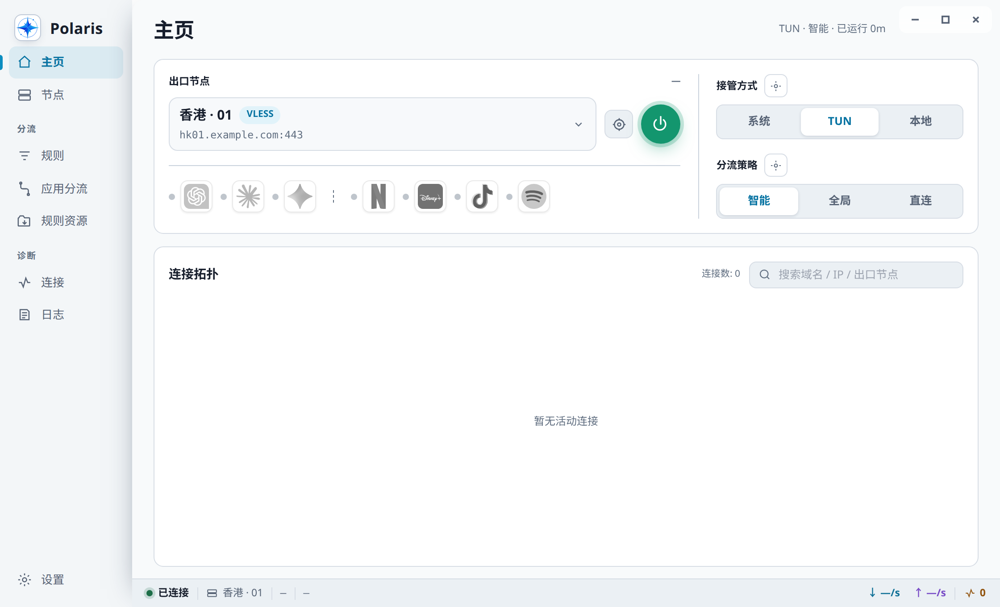
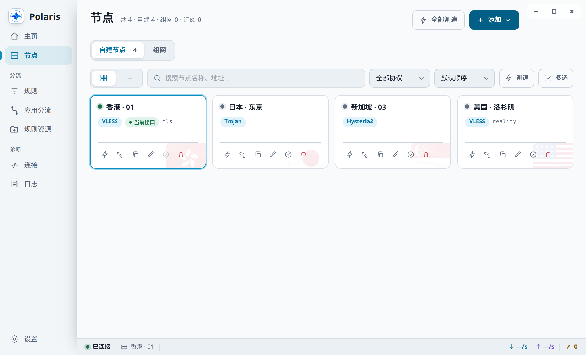
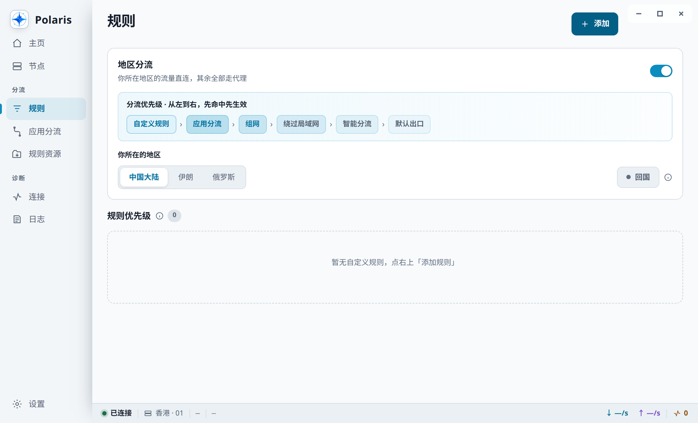
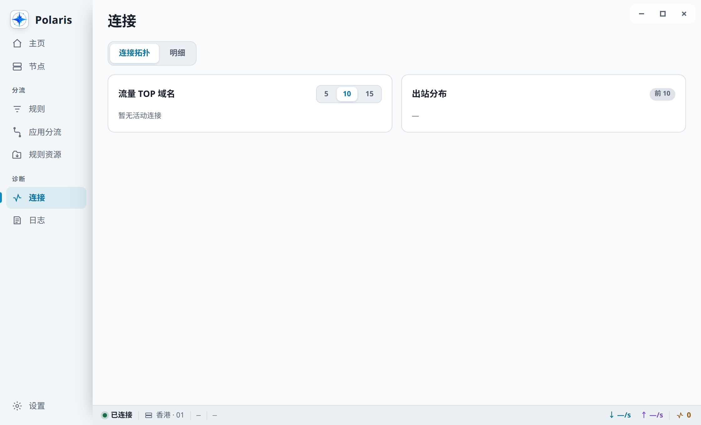
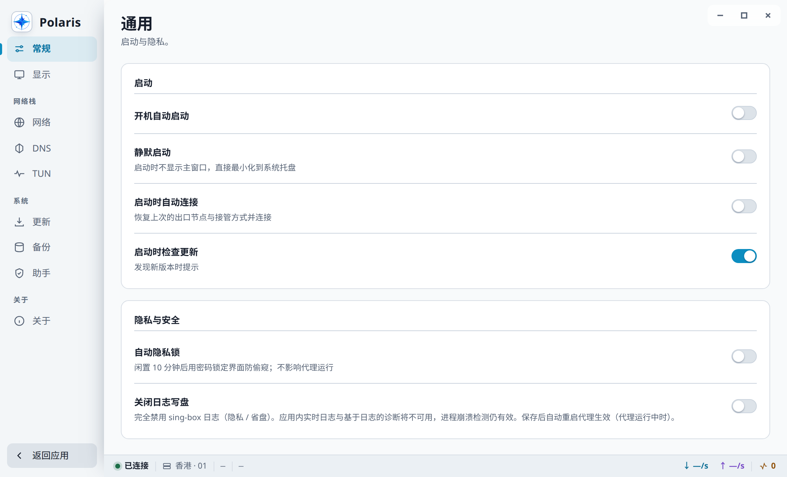

# Polaris

<div align="center">

[简体中文](README.md) · [English](README.en.md) · [繁體中文](README.zh-TW.md) · **Русский** · [فارسی](README.fa.md)

[](https://github.com/polaris-arch/Polaris/releases/latest)
[](https://github.com/polaris-arch/sing-box-polaris)
[](#установка)
[](LICENSE)
[](https://github.com/polaris-arch/Polaris/stargazers)

</div>

**Polaris** — кроссплатформенный клиент сетевого прокси на базе [sing-box-polaris](https://github.com/polaris-arch/sing-box-polaris). Tauri 2 (Rust + React).



## Возможности

| Область | Функции |
|---|---|
| Перехват трафика | TUN · Системный прокси / Локальный порт (ПК) |
| Маршрутизация | Умная / Глобальная / Прямая · Свои правила · Маршрутизация по приложениям · Маршрутизация по регионам (умный режим, включая возврат в Китай) |
| Прокси-узлы | VLESS · VMess · Trojan · Hysteria 2 / 1 · TUIC · Shadowsocks · AnyTLS · Naive · Snell · SOCKS · HTTP · SSH · Tor[1](#tor-note) |
| Подключения Mesh[2](#mesh-note) | WireGuard · Tailscale · WARP (WireGuard) · OpenConnect · OpenVPN · MASQUE[3](#masque-note) |
| DNS | FakeIP · DoH / DoT · Гонка резолверов доменов узлов |
| Управление сетью | Переключатель IPv6 · Блокировка браузерного DoH · Политика WebRTC (только TUN) |
| Диагностика | Топология соединений · Логи в реальном времени · Тесты скорости узлов с отображением прогресса · Отображение сработавших правил · Проверка доступа к стримингу и ИИ-сервисам |
| Эксплуатация | Управление подписками · Резервное копирование и восстановление конфигурации с подтверждением · Блокировка приватности · Работа в системном трее на ПК |
| Обновление приложения | Стабильный / тестовый каналы · Повторная загрузка текущей версии · Проверка дайджеста установщика и предупреждение о его отсутствии |
| Оптимизация памяти на ПК | При включённом автоматическом облегчённом режиме основной WebView освобождается после 10 минут непрерывно скрытого или свёрнутого главного окна; статистика, соединения и логи подписываются по требованию |

<a id="tor-note"></a>

1. Для Tor нужен доступный исполняемый файл Tor и необходимые условия выполнения на платформе.

<a id="mesh-note"></a>

2. OpenConnect, OpenVPN и MASQUE добавляются через Mesh. Маршрутизация во внутреннюю сеть также зависит от настроенных внутренних подсетей (meshRoutes); сама категория входа не подтверждает эту возможность.

<a id="masque-note"></a>

3. MASQUE использует собственную реализацию sing-box и не поддерживает подключение к официальному сервису MASQUE Cloudflare, включая WARP через MASQUE. Ограничение относится именно к этому способу подключения.

<table>
<tr>
<td width="50%"><br><sub>Управление узлами и тесты скорости</sub></td>
<td width="50%"><br><sub>Свои правила маршрутизации</sub></td>
</tr>
<tr>
<td><br><sub>Соединения в реальном времени</sub></td>
<td><br><sub>Настройки</sub></td>
</tr>
</table>

## Установка

Скачайте пакет для своей платформы со страницы [Releases](https://github.com/polaris-arch/Polaris/releases).

Текущий процесс выпуска использует имена файлов из [release-assets.mjs](scripts/release-assets.mjs); `<version>` — версия приложения без префикса `v`. Для macOS предусмотрены отдельные пакеты Apple Silicon / Intel, для Windows — x64, для Linux — amd64. Пакеты Android перечислены в порядке ARM64, ARMv7 и universal; universal содержит только эти две архитектуры ARM, без x86. Наличие загрузок определяется фактическими файлами выбранного релиза. Проверьте файлы по `SHA256SUMS` на странице релиза.

| Платформа | Файл |
|---|---|
| macOS | `Polaris_<version>_aarch64-mac.dmg` / `Polaris_<version>_x64-mac.dmg` |
| Windows | `Polaris_<version>_x64-win-setup.exe` / `Polaris_<version>_x64-win-Portable.zip` |
| Linux | `Polaris_<version>_amd64-linux.deb` / `Polaris_<version>_amd64-linux.AppImage` |
| Android | `Polaris_<version>_arm64-v8a-android.apk` / `Polaris_<version>_armeabi-v7a-android.apk` / `Polaris_<version>_universal-android.apk` |

Настольные пакеты не подписываются платным сертификатом подписи кода; при первом запуске может потребоваться ручное разрешение.

Установщик Windows не содержит встроенного WebView2 Runtime; при его отсутствии в системе он загружается из сети. Если у вас урезанная сборка / LTSC или портативная версия без Runtime, сначала установите [Microsoft Edge WebView2 Runtime](https://developer.microsoft.com/microsoft-edge/webview2/) с сайта Microsoft. Polaris не поставляет офлайн-установщик WebView2.

### Первая установка на macOS

1. Откройте DMG и перетащите `Polaris.app` в «Программы» (Applications). Не запускайте приложение прямо из DMG.
2. Откройте «Терминал» и выполните:

   ```bash
   xattr -cr /Applications/Polaris.app
   ```

3. Запустите Polaris из «Программ». Выполняйте команду один раз после каждой ручной установки или замены из заново скачанного DMG; обновления внутри приложения сами снимают атрибут карантина.

Если Polaris установлен в другом каталоге, замените путь на фактический путь к `.app`. `xattr -cr` рекурсивно очищает расширенные атрибуты этого бандла, поэтому выполняйте её только для пакета Polaris, скачанного из Releases этого репозитория и признанного доверенным. В корне DMG файл `README First.txt` содержит ту же инструкцию на пяти языках. Если система лишь сообщает, что не удалось проверить разработчика, можно вместо этого нажать правой кнопкой на Polaris в Finder → «Открыть» → подтвердить ещё раз.

### Первая установка на Windows

При появлении SmartScreen выберите «Подробнее» → «Выполнить в любом случае».

## Сборка

Раздел предназначен для разработчиков, собирающих текущий исходный код; пример приведён для Linux. Успешная сборка исходного кода не подтверждает проверку работы опубликованных пакетов. Зависимости платформ, мобильные инструменты и правила упаковки описаны в руководствах ниже.

Сборка из исходного кода: [настольные платформы и Android](docs/build-and-package.en.md) · [iOS / iPadOS](docs/ios-source-build.md) · [мобильное ядро и фиксированные инструменты](scripts/mobile-core/README.md).

Для iOS сейчас не публикуются IPA или пакеты для jailbreak; совместимость с jailbreak не проверена. Самостоятельная подпись для устройства без jailbreak требует аккаунта Apple Developer Program с возможностью Network Extension и [профилей provisioning](https://developer.apple.com/documentation/technotes/tn3125-inside-code-signing-provisioning-profiles), соответствующих правам App, PacketTunnel и App Group. Бесплатная [Personal Team не поддерживает NE provider](https://developer.apple.com/forums/thread/128767), а установка вне магазина сама по себе не даёт этих прав. Успешная компиляция или установка не заменяет проверку работы.

Требуются Rust stable, Node.js 24+ (в CI сейчас Node 26), pnpm 11.24.0, Go и [Tauri CLI 2](https://v2.tauri.app/).

```bash
npm install -g "@tauri-apps/cli@$(cat scripts/tauri-cli.version)"
pnpm --dir ui install --frozen-lockfile   # зависимости фронтенда
# Ядро для ПК: закреплённый релиз из desktopRelease в core-manifest.json
node scripts/fetch-core.mjs --platform=linux
# Нативные проверочные пакеты и подготовка ресурсов: docs/build-and-package.en.md
node scripts/fetch-cronet.mjs --platform=linux  # загрузка libcronet.so рядом с ядром Linux
node scripts/fetch-dashboard.mjs   # загрузка встроенной панели
tauri build --config src-tauri/tauri.linux.conf.json
```

Ядро не хранится в репозитории и должно быть загружено перед сборкой пакета. Платформенный `--config` обязателен: без него получится **пакет без ядра**, причём во время сборки не будет ни одной ошибки — сбой проявится только во время работы. Полное описание, разделение задач в CI и контракт выбора пакета для установщика Windows и обновлятора — в [Сборка и упаковка](docs/build-and-package.en.md).

Проверки разработки:

```bash
cargo fmt --all -- --check
cargo clippy --workspace --all-targets -- -D warnings
cargo test --workspace
cd ui && npx pnpm@11.24.0 test
```

## Архитектура

```
ui/          React + Zustand + Vite + Tailwind
src-tauri/   Главный процесс Tauri 2
crates/      доменные crate (config-engine / core-supervisor / helper / updater / …)
resources/   Ядро sing-box + libcronet (загружаются при сборке, в репозитории не хранятся)
```

На настольных платформах (Windows / macOS / Linux) ядро работает как дочерний процесс-sidecar и управляется через gRPC. Привилегированные операции — запуск ядра для TUN и системный перехват — делегируются helper-процессам на Rust на всех трёх платформах; путь System Proxy, которому helper не нужен, управляется напрямую crate `system-integration` на стороне приложения, он же отвечает за откат.

На Android libbox загружается в процесс приложения и используется мобильная интеграция VPN, а не описанный выше настольный путь sidecar/helper.

## Документация

| Файл | Содержание |
|---|---|
| [docs/architecture.md](docs/architecture.md) | Текущие слои, транзакции выполнения, DNS / маршрутизация, границы привилегий и критерии разделения больших файлов (только на китайском) |
| [docs/build-and-package.en.md](docs/build-and-package.en.md) | Сборка, CI, инварианты упаковки, контракт выбора пакета обновлятором |
| [docs/troubleshooting.ru.md](docs/troubleshooting.ru.md) | Ограничения совместимости MASQUE, замечания о неподписанных сборках, белый экран / артефакты отрисовки / сбои GPU |

Скриншоты генерируются командой `node scripts/capture-screenshots.mjs`: headless Chrome отрисовывает собранный фронтенд с подставленными тестовыми данными — устанавливать приложение и запускать ядро не нужно.

## Апстрим

| Проект | Назначение |
|---|---|
| [sing-box-polaris (используемый форк)](https://github.com/polaris-arch/sing-box-polaris) | Форк ядра, используемый Polaris; фиксированные исходники, версия и файлы polaris-box определяются выбранным манифестом сборки |
| [sing-box (исходный upstream)](https://github.com/SagerNet/sing-box) | Исходный проект и техническая основа; благодарность разработчикам |
| [Tauri 2](https://github.com/tauri-apps/tauri) | Десктопная среда выполнения |
| [cronet-go](https://github.com/SagerNet/cronet-go) | libcronet для NaiveProxy |
| [sing-box-dashboard](https://github.com/SagerNet/sing-box-dashboard) | Встроенная панель |
| [meta-rules-dat](https://github.com/MetaCubeX/meta-rules-dat) | Наборы правил и гео-данные (`.srs`) |

Авторские права на каждый компонент принадлежат его авторам. Компоненты, интегрированные как подпроцессы или бинарные файлы, перечислены в `NOTICE`; зависимости уровня исходного кода, линкуемые в артефакты (Tauri / React / несколько сотен Rust crate), перечислены по пакетам в `THIRD-PARTY-LICENSES.md`.

## Область применения и отказ от ответственности

Polaris — это универсальный клиент сетевого прокси и инструмент диагностики. Он не предоставляет, не продаёт и не обслуживает прокси-узлы, подписки и сетевые услуги. Используйте его только там, где вы соблюдаете законы и нормативные акты своей юрисдикции, применимые условия обслуживания и правила сети, в которой находитесь, и где у вас есть необходимые разрешения. Запрещается использовать его для несанкционированного доступа, нарушения прав других лиц или иного противоправного злоупотребления. Пользователь сам оценивает надёжность конфигураций, узлов и сторонних ресурсов и отвечает за свои действия и их последствия.

Программное обеспечение предоставляется «как есть», без гарантий доступности сети, анонимности, безопасности, доступа к какому-либо конкретному сервису или целостности данных. Изменения TUN, системного прокси, DNS и маршрутизации могут временно нарушить сетевое соединение; перед важными операциями сделайте резервную копию конфигурации. За исключением случаев, прямо предусмотренных применимым правом, сопровождающие и участники проекта не несут ответственности за прямые или косвенные убытки, возникшие в результате использования или невозможности использования этого ПО. Настоящее уведомление не является юридической или иной профессиональной консультацией.

## Лицензия

Собственный исходный код Polaris — MIT (см. `LICENSE`). **Условия распространения собранного артефакта различаются по платформам:**

- **Десктоп (Windows / macOS / Linux): MIT.** sing-box (GPLv3) интегрирован как дочерний процесс-sidecar; согласно позиции mere aggregation это не влияет на лицензию проекта. **Эта позиция не проверена судом** — см. `NOTICE`.
- **Android: целиком GPLv3.** Там sing-box может работать только как libbox, загружаемый в процесс приложения (дескриптор tun доступен только через внутрипроцессный интерфейс), поэтому mere aggregation неприменима; слой Kotlin к тому же портирован из sing-box-for-android под GPLv3. Получая APK, вы получаете GPLv3; беря только MIT-исходники этого репозитория, вы по-прежнему получаете MIT.

Сторонние компоненты и полное обоснование — в `NOTICE`.

## История звёзд

<a href="https://www.star-history.com/?repos=polaris-arch%2FPolaris&type=date&legend=top-left">
  <picture>
    <source media="(prefers-color-scheme: dark)" srcset="https://api.star-history.com/chart?repos=polaris-arch/Polaris&type=date&theme=dark&legend=top-left&sealed_token=TJg9RA5l3wyd1IgSMMq05QxhNvxS_OcrWbDJxZuwdUwgs-zVIBeoZz2j6swI3y5BxlztkoJMSkkxL6ZbZtw6oyqaRHZSAv0ZS60aVPPuBMdvm8tkxUjyKN1ttiVtPUwJEKObGpBH7BsPhjr6JwFfl_20UYjxgRVOq_V_Q6gKleib6K8LqP3K3nSwPvIJ" />
    <source media="(prefers-color-scheme: light)" srcset="https://api.star-history.com/chart?repos=polaris-arch/Polaris&type=date&legend=top-left&sealed_token=TJg9RA5l3wyd1IgSMMq05QxhNvxS_OcrWbDJxZuwdUwgs-zVIBeoZz2j6swI3y5BxlztkoJMSkkxL6ZbZtw6oyqaRHZSAv0ZS60aVPPuBMdvm8tkxUjyKN1ttiVtPUwJEKObGpBH7BsPhjr6JwFfl_20UYjxgRVOq_V_Q6gKleib6K8LqP3K3nSwPvIJ" />
    
  </picture>
</a>
